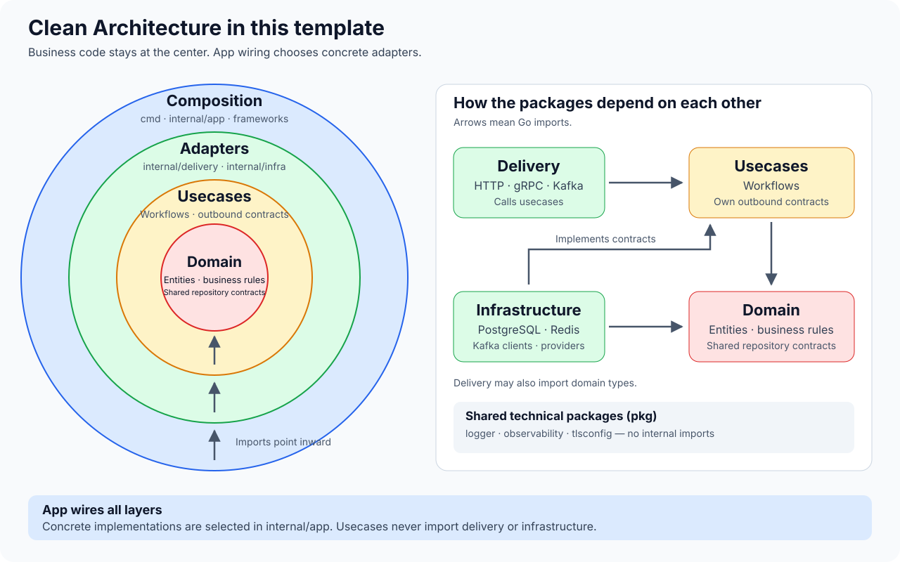
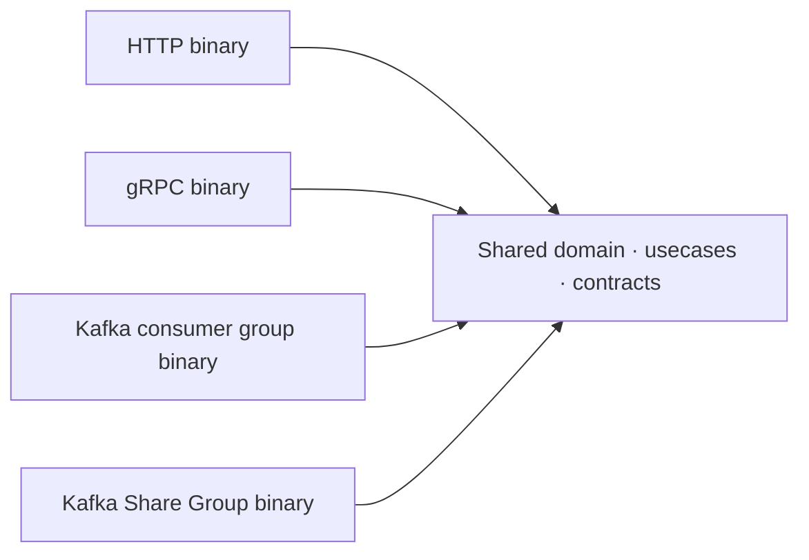
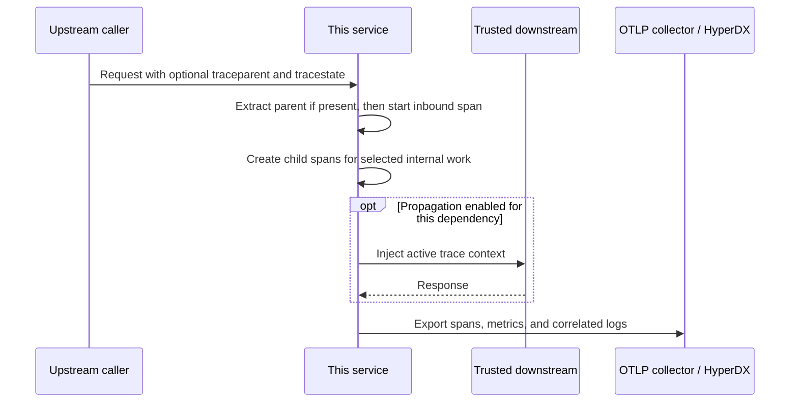

# Go Backend Architecture


[](https://github.com/eannchen/go-backend-architecture/actions/workflows/quality.yml)
[](https://github.com/eannchen/go-backend-architecture/actions/workflows/integration.yml)

A modular Go backend template with independently runnable HTTP, gRPC, and Kafka applications. Clean Architecture keeps business workflows separate from transport and infrastructure. Shared foundations cover security, data access, observability, testing, and lifecycle management.

## Table of Contents

- [Included capabilities](#included-capabilities)
- [Architecture](#architecture)
- [Delivery adapters](#delivery-adapters)
- [Runtime reliability](#runtime-reliability)
- [Observability](#observability)
- [Data design](#data-design)
- [Testing and CI](#testing-and-ci)
- [AI agent setup](#ai-agent-setup)
- [Third-party tools](#third-party-tools)
- [Repository map](#repository-map)
- [Use as a Starter](#use-as-a-starter)

## Included capabilities

- **Architecture**: Clean Architecture with clear layer boundaries, explicit dependency wiring, focused interfaces, and independently runnable binaries
- **Public HTTP**: OpenAPI-generated request and response models, OTP/OAuth sessions, CORS and security headers, Redis rate limiting, health endpoints, and Server-Sent Events
- **Service gRPC**: Protobuf services, standard and detailed health APIs, interceptors, TLS/mTLS caller identity, reflection controls, and outbound client building blocks
- **Kafka**: Consumer group and Share Group binaries, topic routing, independent workflow settings, TLS/SASL clients, bounded concurrent handling, optional record-lock renewal, and processing middleware
- **Relational storage**: SQL-first PostgreSQL with sqlc for static queries, Squirrel for dynamic queries, Goose migrations, and repository-owned transaction boundaries
- **Cache and key-value state**: Redis adapters for caching, sessions, OTP, OAuth state, and atomic rate limiting, with explicit composition
- **Observability**: OpenTelemetry traces, metrics, and log emission; Zap output; OTLP export; optional request-ID interoperability
- **Testing**: Layer-owned unit tests, transport workflow tests, and container-backed PostgreSQL, Redis, and Kafka integration tests
- **CI**: Static checks, race-enabled tests, integration tests, and validation of all four selectable project profiles
- **AI agent setup**: Guidance for Codex, Claude, Cursor, and GitHub Copilot, plus an optional phased TDD workflow

## Architecture

Imports follow the arrows below. Usecases never import delivery or infrastructure.



The circles group responsibilities; the package diagram shows imports, not execution order.

| Layer | Responsibility |
| --- | --- |
| `internal/delivery` | Inbound protocol handling, transport validation, and response mapping |
| `internal/usecase` | Application workflows, business decisions, and their outbound dependency contracts |
| `internal/domain` | Business entities, reusable invariants, and shared business repository contracts |
| `internal/infra` | Persistence, caching, messaging, and external-service adapters |
| `pkg` | Reusable technical libraries: logging, observability, TLS configuration, and gRPC metadata helpers |
| `internal/app` and `cmd` | Concrete dependency selection, process lifecycle, and startup |

Interfaces belong beside their consumers: delivery defines the usecase behavior it needs, and usecases define outbound dependencies. Shared business repositories belong in domain, such as `internal/domain/user`. Infrastructure implements contracts; app wiring checks compatibility through Go's implicit interfaces.

### Multi-binary composition

Each binary has a `cmd` entry point and `internal/app` composition root. Binaries reuse domain, usecases, and adapters, and can be deployed and scaled independently.



### SOLID in this codebase

Package boundaries and dependency direction apply SOLID:

- **S — Single responsibility:** delivery maps protocols, usecases coordinate workflows, infrastructure integrates technologies, and app wires dependencies.
- **O — Open/closed:** add adapters behind existing contracts and select them in app wiring; change contracts when application needs change.
- **L — Liskov substitution:** adapters and test doubles preserve the contract's result, error, cancellation, and consistency semantics.
- **I — Interface segregation:** interfaces expose the behavior their callers need, rather than broad CRUD or vendor APIs.
- **D — Dependency inversion:** business code depends on contracts; app wiring injects implementations. Delivery does not construct stores or clients.

### Core design patterns

| Pattern | Use in this template |
| --- | --- |
| Composition root | `internal/app` selects concrete implementations and owns startup and shutdown order. |
| Adapter | Delivery adapters translate external input and application outcomes; infrastructure adapters implement application contracts with storage or external services. |
| Repository | Usecases request behavior through contracts shaped around their workflows, while infrastructure owns persistence and provider details. |
| Decorator | A composed repository or cache wrapper adds caching or coordination without changing the usecase-facing contract. |
| Strategy | Provider, security, and client policies are selected through small contracts or configuration where behavior must vary. |
| Middleware/interceptor | Cross-cutting transport behavior is applied consistently around HTTP requests, gRPC calls, and Kafka record handling. |
| Null object | Optional behavior can use a safe no-op implementation instead of spreading nil checks through callers. |

The complete dependency, placement, error, performance, and testing rules are in [`AGENTS.md`](AGENTS.md).

## Delivery adapters

Keep all four applications or select one profile. Each delivery adapter owns transport validation and outcome mapping while sharing usecases and infrastructure.

### Public HTTP

The HTTP application handles browser and public API traffic.

| Concern | Design |
| --- | --- |
| Contract | `contracts/http/openapi.yaml` defines endpoints and portable validation; oapi-codegen produces delivery-only models. |
| Server | Echo routes call feature handlers, which bind generated transport models and invoke usecases. |
| Request context | Preserves caller cancellation, applies a configurable deadline except for SSE, and handles optional request IDs through configurable request and response headers. |
| Responses | One responder maps application errors and context cancellation to stable HTTP status and JSON payload semantics. |
| Authentication | OTP and optional Google OAuth create Redis-backed sessions with secure cookie defaults. |
| Edge protection | Body limits, security headers, CORS allowlists, trusted-proxy client IP extraction, and Redis token-bucket rate limiting run at the origin. |
| Streaming | A bounded SSE example covers flush, disconnect, timeout, and goroutine ownership. |

The request path is ordered deliberately:

```text
body limit → observability → recovery → security/CORS → request context → rate limit → handler → usecase
```

See [`internal/delivery/http/README.md`](internal/delivery/http/README.md) for package ownership and extension guidance.

### Service-to-service gRPC

The gRPC application handles service-to-service calls through Protobuf services and messages.

| Concern | Design |
| --- | --- |
| Contract | Versioned Protobuf under `contracts/grpc` defines services and messages; Buf lints the contract, checks breaking changes, and generates delivery-only Go types. |
| Server | grpc-go services map generated messages to usecase input. |
| Request context | Preserves caller cancellation and deadlines, adds a unary server timeout, and handles optional request IDs through configurable metadata keys. |
| Responses | One responder maps application and context errors to gRPC status codes and safe messages. |
| Caller identity | When mTLS is enabled, a verified client certificate URI can become a transport-authenticated service identity. Authorization remains a usecase decision. |
| Outbound calls | Shared connection mechanics and opt-in interceptors are available, while each remote dependency owns its methods, deadlines, retries, metadata, and telemetry policy. |

The unary and stream interceptor chain follows the same ownership model as HTTP middleware:

```text
request context → optional caller identity → observability → recovery → service → usecase
```

Recovery runs inside observability so recovered panics appear in telemetry. HTTP starts observability first because Echo lets it read the updated request context on return. CORS runs before rate limiting so preflight requests can finish early.

gRPC cannot pass an updated context outward, so context and caller identity run before observability. Authentication and rate limiting can be added at the service boundary or enforced by a gateway or service mesh.

See [`internal/delivery/grpc/README.md`](internal/delivery/grpc/README.md) and [`internal/infra/grpcclient/README.md`](internal/infra/grpcclient/README.md) for the server and outbound-client boundaries.

### Kafka consumers

Both Kafka binaries use [franz-go](https://github.com/twmb/franz-go). A record is a Kafka message. The Share Group reader requires Kafka 4.2+; local development and integration tests use 4.2.1.

| Mode | Work assignment and completion | Template behavior |
| --- | --- | --- |
| Consumer group (`kafkaworker`) | Each partition belongs to one consumer in the group at a time. A committed offset saves where that group should resume. | Handles one record at a time per reader and commits after success. Handling or commit failure stops that consumer without advancing past the failed record. |
| Share Group (`kafkashareworker`) | Members can process different records from the same partition concurrently. Kafka temporarily locks each acquired record and accepts individual acknowledgments. | Uses a bounded handler pool. Successful handling queues Accept; invalid input queues Reject; other failures queue Release and stop the consumer after handlers finish. Record order is not preserved. |

Notification and activity processing demonstrate different topic handlers with separate readers and group settings. Both usecases log simulated work. Set `KAFKA_NOTIFICATION_TOPIC` or `KAFKA_ACTIVITY_TOPIC` to empty to disable that workflow. A reader can subscribe to several topics that share consumer settings.

The processing chain is shared by both modes:

```text
record context and deadline → observability → recovery → topic handler → usecase
```

Consumer groups delay partition reassignment during handling and committing. Share Groups instead lock individual records; optional best-effort renewal extends locks for running and queued work. Both modes can redeliver records, so handlers must handle repeated delivery safely.

Share Group acknowledgments are asynchronous. The default callback logs failures and continues; app wiring can request shutdown instead. Explicit mode requires a decision for every fetched record before another poll; implicit mode lets the next poll accept undecided records. Reader comments cover renewal, recovery, and flushing options.

**Fan-out:** different group IDs let independent workflows each read the same topic. **Fan-in:** multiple producers can write to one topic; combining related records requires application logic. Keys can select partitions, but Kafka does not inspect payloads to choose handlers.

The [Kafka clients](internal/infra/messaging/kafka) provide publishing, both reader modes, and TLS/SASL options. See [`config/env`](config/env) for workflow settings and client comments for API behavior and setup examples.

## Runtime reliability

The template makes request limits, background work, and shutdown explicit.

- Cancellation and deadlines reach storage and outbound calls, so work can stop when a caller disconnects or its time limit expires.
- Background tasks use an application-lifecycle context, not a request context. The component that starts a goroutine controls how it stops and waits for it to finish; concurrent work is bounded.
- Retries have bounded attempts and repeat writes only when an idempotency design makes that safe.
- Shutdown is coordinated across application paths, uses bounded cleanup contexts, stops components in reverse dependency order, and reports cleanup failures.
- Kafka applications can stop all consumers on a failure (`stop-all`, the default) or leave healthy consumers running (`independent`) through `KAFKA_WORKER_FAILURE_POLICY`. Each consumer owns its reader; telemetry stays available until reader cleanup finishes.
- Errors retain their original causes; unexpected failures are logged once where they are handled.

See [`AGENTS.md`](AGENTS.md) for the corresponding implementation rules.

## Observability

Reusable contracts and implementations live in `pkg/observability` and `pkg/logger`. These packages own typed configuration and import no project `internal` packages. App wiring loads settings and injects dependencies, including explicit OpenTelemetry providers.

| Signal | What it records |
| --- | --- |
| Traces | Inbound boundaries and selected usecase, storage, or outbound operations, with outcome and error details |
| Metrics | Transport and application operation counts and durations, with bounded dimensions |
| Logs | Structured events from any layer, correlated with active trace/span IDs and optional request IDs |

### Trace propagation and correlation

A request can continue one trace across services:



The SDK creates trace and span IDs locally, even without a collector. Inbound adapters extract parent context; internal spans inherit it. Selected outbound clients inject context for trusted downstream services. External providers do not receive it automatically.

Zap and OTLP logs use active trace/span IDs, letting HyperDX link logs to traces. Local logs remain useful when export fails, but cannot replace uncollected spans.

`x-request-id` is a separate optional correlation ID. HTTP and gRPC accept valid caller-provided IDs under configurable keys and may return them; neither generates missing IDs. Selected internal clients can propagate them explicitly.

Traces and logs can include safe request details. Metrics use bounded labels, such as `/users/:id` and status code, rather than concrete paths or IDs that create many series.

Kafka clients use kotel hooks for client traces, metrics, and trace-header propagation. Delivery middleware measures individual handling attempts; successful handling does not mean the later commit or acknowledgment succeeded. Message keys are excluded from kotel trace attributes.

See [`pkg/observability/README.md`](pkg/observability/README.md) and the transport instrumentation guides for [HTTP](internal/delivery/http/middleware/observability/README.md) and [gRPC](internal/delivery/grpc/interceptor/observability/README.md).

## Data design

### SQL-first PostgreSQL

SQL and generated types stay inside infrastructure. Explicit SQL makes joins, batching, locking, and selected columns reviewable. This costs more SQL and mapping code than an ORM, but keeps query behavior under application control.

| Tool | Role |
| --- | --- |
| pgx | PostgreSQL connection pool, driver behavior, and low-level database integration |
| sqlc | Go types and methods generated from static SQL |
| Squirrel | Parameterized construction for queries whose shape changes at runtime |
| Goose | Ordered database migrations for existing environments |

Repository methods follow usecase needs. Shape reads to avoid N+1 queries, keep transaction handles inside PostgreSQL adapters, and evaluate indexes and material query changes with query plans. See [`AGENTS.md`](AGENTS.md) for detailed rules.

### Redis caching and state

Redis holds replaceable cached data and feature state such as sessions, OTPs, and rate-limit counters. Each adapter owns its failure policy.

| Package role | Responsibility |
| --- | --- |
| Cache store | Stores replaceable copies of data with serialization and TTL behavior. |
| Key-value store | Owns sessions, OTPs, OAuth state, and rate-limit state whose Redis operations are part of the feature's behavior. |
| Composed adapter | Coordinates a primary repository and supporting cache behind one repository contract. |

The user store demonstrates cache-aside: check Redis, read PostgreSQL on a miss, then populate the cache. Each policy must define acceptable staleness and how read, write, and invalidation failures affect the operation.

`internal/infra/redisconn` creates Redis clients; cache and key-value stores receive them through injection. App composition chooses whether stores share one connection pool or use separate clients or Redis instances, and closes each owned client once.

See [`internal/infra/db/postgres/store/README.md`](internal/infra/db/postgres/store/README.md) and [`internal/infra/composed/README.md`](internal/infra/composed/README.md) for adapter-specific guidance.

## Testing and CI

Unit tests isolate one component; integration tests exercise real transport or backend boundaries.

| Scope | What is tested | Current examples |
| --- | --- | --- |
| Unit | One domain, usecase, delivery, or infrastructure component with its dependencies controlled | Business rules, response mapping, and middleware/interceptor behavior |
| Infrastructure integration | A real adapter against a disposable backend | PostgreSQL and Redis stores; Kafka publishing, commits, rebalances, acknowledgments, renewal, and shutdown with Testcontainers |
| Transport integration | A request or record through the real delivery path | HTTP authentication with PostgreSQL and Redis; in-process gRPC health; Kafka workflows with a real broker, usecases, middleware, and telemetry |

Tests use matching source filenames. Infrastructure integration tests stay in adapter packages; transport workflows live under `internal/delivery/<transport>/integration`. Reusable doubles belong to the contract owner's `<owner>test` package. Full rules are in [`AGENTS.md`](AGENTS.md).

| CI check | What it verifies |
| --- | --- |
| Build and race-enabled tests | Formatting, vet, build, and all untagged Go tests |
| Integration tests | PostgreSQL, Redis, and Kafka adapters; HTTP, gRPC, and Kafka delivery workflows |
| Template profiles | Selects each of the four profiles, generates its database code, then builds and tests the result |

## AI agent setup

The repository keeps coding guidance in one place so agents follow the same conventions.

### Rules

| File | Purpose |
| --- | --- |
| [`AGENTS.md`](AGENTS.md) | Shared implementation and communication rules, including contract ownership, validation boundaries, and testing conventions; read by Codex and Cursor. |
| [`.claude/CLAUDE.md`](.claude/CLAUDE.md) | Imports the shared rules for Claude instead of maintaining a divergent copy. |
| [`.github/copilot-instructions.md`](.github/copilot-instructions.md) | Tells GitHub Copilot to consult `AGENTS.md` for the shared rules. |

### Skills

| File | Purpose |
| --- | --- |
| [`.agents/skills/tdd-change/SKILL.md`](.agents/skills/tdd-change/SKILL.md) | Canonical TDD workflow available to Codex, Cursor, and GitHub Copilot. |
| [`.claude/skills/tdd-change/SKILL.md`](.claude/skills/tdd-change/SKILL.md) | Links the canonical workflow for Claude. |

Invoke `$tdd-change` in Codex or `/tdd-change` in Claude, Cursor, or GitHub Copilot with `Red only`, `Green only`, `Refactor only`, or `Complete cycle`. Green requires the failing tests from Red; Refactor requires passing tests. The skill follows `AGENTS.md`, including the capabilities that remain after profile selection.

## Third-party tools

| Concern | Tools |
| --- | --- |
| HTTP | [Echo v5](https://github.com/labstack/echo), [validator](https://github.com/go-playground/validator), [OpenAPI 3](https://spec.openapis.org/oas/latest.html), [oapi-codegen](https://github.com/oapi-codegen/oapi-codegen), [Vacuum](https://github.com/daveshanley/vacuum), [OASDiff](https://github.com/oasdiff/oasdiff) |
| gRPC | [grpc-go](https://github.com/grpc/grpc-go), [Protocol Buffers](https://protobuf.dev/), [Buf](https://buf.build/) |
| PostgreSQL | [pgx](https://github.com/jackc/pgx), [sqlc](https://sqlc.dev/), [Squirrel](https://github.com/Masterminds/squirrel), [Goose](https://github.com/pressly/goose) |
| Redis | [go-redis](https://github.com/redis/go-redis) |
| Kafka | [franz-go](https://github.com/twmb/franz-go), [kotel](https://pkg.go.dev/github.com/twmb/franz-go/plugin/kotel), [Apache Kafka](https://kafka.apache.org/) |
| Authentication | [OAuth2 for Go](https://pkg.go.dev/golang.org/x/oauth2), [Resend](https://resend.com/) |
| Observability | [OpenTelemetry](https://opentelemetry.io/), [OTLP](https://opentelemetry.io/docs/specs/otlp/), [Zap](https://github.com/uber-go/zap), [OpenTelemetry Collector](https://opentelemetry.io/docs/collector/), [HyperDX](https://www.hyperdx.io/) |
| Testing and CI | [Testcontainers for Go](https://golang.testcontainers.org/), [GitHub Actions](https://docs.github.com/actions) |
| Local development | [Air](https://github.com/air-verse/air), [Docker Compose](https://docs.docker.com/compose/) |

## Repository map

```text
cmd/                         process entry points
config/
├── air/                     per-binary live-reload configurations
├── env/                     shared and per-profile environment examples
└── sqlc/                    per-profile database generation configurations
contracts/                   OpenAPI and Protobuf sources
internal/
├── app/                     composition roots and shared runtime lifecycle
├── delivery/                HTTP, gRPC, and Kafka inbound adapters
├── domain/                  business entities, invariants, and shared repository contracts
├── usecase/                 workflows and their outbound dependency contracts
└── infra/                   database, Redis, messaging, and provider adapters
pkg/
├── logger/                  logging contract and Zap implementation
├── observability/           telemetry contracts and OpenTelemetry implementation
├── tlsconfig/               reusable TLS configuration loading
└── grpcmetadata/            gRPC metadata key validation
make/                        capability-owned Make targets
tools/                       profile selection, identity bootstrap, and Kafka setup
```

## Use as a Starter

### Requirements

- [Go 1.27+](https://go.dev/doc/install)
- [Docker](https://docs.docker.com/get-docker/) with [Docker Compose](https://docs.docker.com/compose/install/)
- [GNU Make](https://www.gnu.org/software/make/)

### 1. Choose the source shape

Keep the full template, or preview one of four profiles before bootstrapping:

```bash
# Preview first; no files are changed.
go run ./tools/profile-selector --profile public-http
go run ./tools/profile-selector --profile service-grpc
go run ./tools/profile-selector --profile kafka-worker
go run ./tools/profile-selector --profile kafka-share-worker

# Apply the chosen profile; public-http is shown here.
go run ./tools/profile-selector --profile public-http --apply
```

The selector requires a clean checkout, removes unused profiles and itself, installs root-level `.air.toml`, `sqlc.yaml`, and `.env.example` from `config/`, adjusts sqlc paths, and writes `.template-profile`. Commit the selection before the next step.

### 2. Bootstrap project identity

```bash
./tools/bootstrap-template.sh --module github.com/your-org/your-backend
go mod tidy
```

The bootstrap updates module/import paths, service identity, the main Compose resource names, contract package paths, and the README title. It does not rename the checkout directory or configure the Git remote. If retaining Kafka, review the separate project name in `docker-compose.kafka.yml` as well.

### 3. Start local dependencies and the application

```bash
cp .env.example .env
make install
```

For HTTP or gRPC, start the main local stack:

```bash
make dev-up
make migrate-up  # when the selected source includes database migrations
```

For Kafka profiles, start the separate broker and prepare the enabled topics:

```bash
make dev-kafka-up
# Share Group profile only: configure initial position and record-lock duration.
make kafka-share-group-init
```

Run `make run` for the selected profile, or choose an installed application explicitly:

```bash
make run-httpapi           # HTTP on :8080
make run-grpcapi           # gRPC on :9090
make run-kafkaworker       # consumer group
make run-kafkashareworker  # Share Group
```

Kafka workers reuse runtime configuration and telemetry without opening PostgreSQL or Redis connections. They can run with Kafka alone; set `OTEL_EXPORT_ENABLED=false` if no collector is running. In the full template, Kafka settings use their defaults unless overridden; use the matching `config/env/kafka-*.env.example` fragment as a reference.

Verify the HTTP health endpoint when HTTP is installed:

```bash
curl 'http://localhost:8080/health?check=ready'
```

With [grpcurl](https://github.com/fullstorydev/grpcurl) installed and local reflection enabled, verify the standard gRPC health service:

```bash
grpcurl -plaintext \
  -d '{"service":"diagnostics.v1.DiagnosticsService"}' \
  localhost:9090 grpc.health.v1.Health/Check
```

For either Kafka profile, publish an example to the default notification topic:

```bash
printf '%s\n' '{"request_id":"req-1","recipient":"user-1","content":"Your report is ready"}' | \
  docker compose -f docker-compose.kafka.yml exec -T kafka \
  /opt/kafka/bin/kafka-console-producer.sh \
  --bootstrap-server kafka:19092 --topic notifications.requested.v1
```

The worker logs the simulated notification. Use your configured topic name if it differs from the default. The local broker has one replica per partition, no TLS or SASL, and persistent storage; stopping it preserves records and group progress.

The main local stack exposes PostgreSQL on `5432`, Redis on `6379`, HyperDX on `8081`, and OTLP on `4317`/`4318`. Kafka runs in a separate Compose project on `9092`.

### 4. Verify the project

```bash
make check             # formatting, vet, and build
make test              # unit tests
make test-race         # unit tests with race detection
make test-integration  # transport and infrastructure integration tests
make ci                # complete sequence once the project has a contract baseline
```

During the initial identity bootstrap, use the individual checks before comparing contracts with an earlier commit. Later, `make ci` runs contract compatibility checks against the configured Git baseline as well as the complete test sequence.

Contract-specific commands are available when their capability is installed:

```bash
make openapi-generate openapi-check
make proto-generate proto-check
```

Use `make dev-logs` to follow local infrastructure and `make dev-down` to stop it. Use `make dev-kafka-logs` and `make dev-kafka-down` for the separate Kafka stack; stopping it retains its data volume. HTTP and gRPC processes can be stopped with `make run-httpapi-stop` or `make run-grpcapi-stop`; stop Kafka workers with Ctrl-C.
